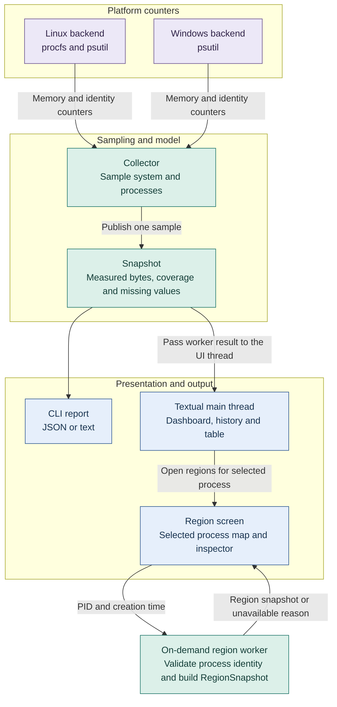

> **File name** `architecture.md` 
> **Full path** `E:\ramtaskman\docs\architecture.md` 
> **Path relative to the ramtaskman repository** `docs/architecture.md`

# Architecture

We develop and test ramtaskman on Linux and Windows. The macOS backend is
experimental: we don't have a Mac, so we haven't tested or validated it.
Our own testing and CI cover Linux and Windows.

## Data flow

The collector is independent of Textual. `make_backend()` selects `LinuxBackend`
on Linux or `PsutilBackend` configured for Windows/macOS. Each backend exposes
`read_system()`, `read_process()`, `name`, `source` and `unsupported` (metric → reason).
`models.py` depends on neither Textual nor psutil. The UI uses a cancellable worker
thread and passes samples to the main thread. `worker.cancelled_event.wait()`
allows shutdown without waiting for the entire sampling interval.

## Linux sources

| Data | Source | Note |
|---|---|---|
| Total, available, cache, slab, system swap | /proc/meminfo | Bytes after kB × 1024 conversion |
| RSS, PSS, USS, Swap, SwapPSS | /proc/PID/smaps_rollup | USS = Private_Clean + Private_Dirty |
| RSS when rollup is inaccessible | psutil.memory_info | Fallback; PSS and USS remain null |
| Name, UID, executable, creation time | psutil | No cmdline or environ reads |
| System CPU | psutil.cpu_percent | First reading null |
| Memory pressure | /proc/pressure/memory, some avg10 | Optional |
| Application identity | /proc/PID/cgroup | Metadata limited to 16 KiB, systemd apps for the current UID |
| Breakdown | Same smaps_rollup read | Pss_Anon/File/Shmem, Private/Shared Clean/Dirty, Anonymous, LazyFree, AnonHugePages |
| Selected process regions | /proc/PID/smaps | On-demand read separate from general sampling |

Name and executable access go through `process_identity.py`. Public
`psutil.Process.name()` and `.exe()` APIs may fall back to `cmdline()` and path
checks. The adapter instead isolates psutil 7's native `_proc.name` / `_proc.exe`
getters without using public caches. If an internal API changes or access is denied,
it keeps the PID as a label and leaves the path as None. Linux native names may
be truncated by the kernel; they are not expanded by reading the command line.
Callers still check exited/reused PIDs, including during region reads.

## Windows/macOS sources

`psutil.virtual_memory()` supplies system RAM, `swap_memory()` system swap/pagefile,
`Process.memory_info()` RSS and `memory_full_info().uss` USS. Per-process PSS, Swap
and SwapPSS remain None, with reasons in `Snapshot.unsupported`. There is no conversion
from VMS/private/pagefile: these are different quantities. Generic cache/slab/PSI
fields remain None. A system-swap error preserves RAM data and produces a note.

Windows user identity is domain/name; macOS uses UID. Windows paths are normalized
for case-insensitive comparison. An unknown owner is not a shared identity: that
process remains separate.

`ProcessMemory.key = PID + started_at`; `is_running()` is checked after the read.
Exited/reused PIDs are discarded. Identity metadata errors count towards `skipped`.
smaps errors retain the process with a `reason` and null values.

## Aggregation

`Snapshot.applications` first uses explicit Linux cgroup identity when UID is known,
with `app_source=systemd-cgroup`, full `app_id` and `app_name`. `grouping.py` accepts
the unified and legacy name=systemd hierarchies under the user's app.slice path.
Application units follow the systemd convention; sessions and generic services
are not evidence of application identity. Identity retains the complete instance,
while the name is descriptive only. Do not merge instances just because their
names match. UID mismatch, ambiguous hierarchies or missing readings trigger fallback.

Otherwise, grouping uses `(user, executable)`, or `(user, name)` when the path is
missing. Groups expose `grouping` and `grouping_id`; if members have different
executables, `executable=None`. `ApplicationMemory.total()` returns None if even
one member lacks the metric. `Snapshot.visible_sum()` sums available readings only
and returns None if there are none. Always show coverage alongside totals.

Future grouping must not sum aggregates and their children together or combine
different users. Do not replace missing PSS with RSS or infer shared bytes from
incompatible sums. Pages can change between reads; do not force accounting identities
between sequential samples and system totals.

## UI contract

Preserve IDs `dashboard`, `device`, `system`, `history`, `chart-controls`, `chart-mode`,
`charts`, `chart-note`, `procs`, `inspector` and the original source's classes/styles.
The app title does not take an extra row; the inspector shows mode and sort order.
Charts use 60 samples and a fixed percentage scale. Visible PSS/USS are percentages
of total RAM, swap of total swap, and cache of total RAM. PSI is already a percentage.

## OS memory bar

`memory_segments.partition_meminfo()` builds an accounting partition of `MemTotal`:
AnonPages, Cached−Shmem, Shmem, Buffers, SReclaimable, SUnreclaim, residual Other,
and MemFree. `SystemMemory.segments` contains integer byte values; `segments_reason`
explains a missing partition. These optional fields remain compatible with older
constructors and JSON. Missing or negative fields, Cached<Shmem, a zero total or a
sum above MemTotal produce empty segments with a reason; values are neither clipped
nor normalized. Other is calculated, not a direct kernel measurement or a hardware
reservation outside MemTotal.

`SystemRamBar` is a Rich renderable that receives the actual panel width on every
render, without a fixed cap. The largest-remainder method assigns all row cells
to segments while preserving total length; rounding is visual only and byte values
stay unchanged. Small categories remain in the legend even without a cell.
The bar is not ordered by physical address. The fallback shows used/available in
two colors with an explicit label; Linux categories cannot be derived from RSS/PSS.

## Filters and details

`RowFilter` in filters.py selects rows without changing Snapshot or ApplicationMemory
members. Applications are built before filtering: a helper match preserves the
complete aggregate. A numeric query is an exact PID; otherwise it is a casefolded
substring on names and executables. User, text and memory-state conditions use AND.
Swap requires a positive measurement; partial considers only supported metrics.
Filters precede sorting/Top30 and survive drilldown. The user selector retains a
selected account even if it disappears from the next sample.

The bar is hidden by default; `/` or `f` opens it. CSS reduces dashboard space when
it is open, keeping table and inspector accessible at 80×24. DataTable keys include
a render generation so queued events from an old table cannot change selection
after a refresh.

`detail.py` aggregates a breakdown field only when every member supplies it and
shows coverage per field. `MemoryDetailScreen` freezes a renderable of the selected
sample while the worker continues. `detail_bars()` builds two `MemoryBreakdownBar`
objects: anonymous/file/shmem PSS and private/shared clean/dirty RSS. Each bar declares
its denominator; Swap and SwapPSS remain separate. `MemoryPart` retains bytes,
labels and colors; `cell_widths()` assigns all available cells without changing
values. The legend retains sub-cell components. A zero total is known; missing or
inconsistent fields produce n/a with coverage or a reason.

Consistency is checked per process before aggregation. RSS must equal the sum of
its four components. procfs truncates PSS total and its three components separately
to kB: only a nonnegative remainder of 0/1/2 KiB per process is allowed, with
KiB-aligned values. This remainder is an explicit segment, never normalization.
Source: [Linux __show_smap](https://github.com/torvalds/linux/blob/v6.17/fs/proc/task_mmu.c).
Other counters remain overlapping views and are not added to the bars.
This window does not require reading full smaps.

## Process regions and map

`regions.py` is independent of Textual. `MemoryRegion` contains virtual range,
permissions, offset, device/inode, pathname, heuristic category, RSS/PSS/USS/swap/SwapPSS,
breakdown and VmFlags. `size` is end−start; `key` comes from the range. The parser
checks ordering/overlap, duplicate or negative counters, kB units and Size consistency
when present. Missing fields remain None. USS comes only from Private_Clean+Private_Dirty;
HugeTLB is kept separate. Paths containing spaces and deleted files remain metadata:
they are not opened.

`LinuxRegionReader.read(process, cancelled=...)` reads only the selected PID's smaps.
It checks PID+create_time before and after using fresh psutil instances, avoiding
cached create_time. `RegionSnapshot` retains identity, timestamp, monotonic duration,
regions, completeness and reason. `total()` returns None for incomplete scans or
missing metrics. Permission errors, process exit, changed identity and parsing
errors clear collected data.

Default limits: 32 MiB, 32,768 regions and 3 seconds; an individual line is limited
to 64 KiB. Reaching a limit preserves only completed regions, with `complete=False`.
Time and cancellation are checked between reads; these are not hard syscall timeouts.
No pagemap/PFN, mem, cmdline, environ or mapped-file contents are used.

`RegionScreen` starts a cancellable worker on entry and with `r`, without changing
the normal Collector. Each request clears previous data; `request_id` rejects stale
responses, and result identity is also checked in the UI. Closing the view cancels
the worker and invalidates responses. Windows uses the experimental virtual provider;
macOS displays an unavailable reason without starting Linux reads. Timestamp, age,
duration and complete/partial status remain visible. Region data is not periodically
refreshed; only displayed age updates every second.

`RegionMap` always orders by address, with area proportional to RSS or virtual size.
In the latter mode, holes take no area: `│` marks a visible transition across a hole
or filtered-out region. This is a virtual map, not a physical layout. Missing RSS
prevents drawing a falsely complete bar. Sub-cell regions remain in the table.
Type describes mapping origin: file-backed does not rule out private anonymous
CoW pages, and anonymous does not imply heap or stack.

Search and selectors filter name, type, permissions or a 0x address inside the range.
Resident/swap states require positive measurements; shared requires both shared
clean/dirty counters and a positive sum. Table sorting supports RSS/PSS/size/start;
table selection and bar clicks are synchronized. `z` or Enter limits the map to
up to two neighbors on each side within the filtered set. Totals and titles always
identify the displayed regions. Esc clears open filters, then zoom, then closes.
Table keys include a generation to reject stale events. Dashboard and inspector
scroll in narrow terminals.

## CLI contract

A/B comparison uses `capture_models.py` for immutable copies and `comparison.py`
for ranges, identity, origin changes and deltas; a partial reading does not prove
disappearance. `capture_io.py` and `capture_dialog.py` save and open versioned
captures, separate from general JSON, with limits and validation described in the
[capture schema](schema-capture.md). `replay.py` opens the same view without creating
a collector or provider; live refresh is disabled. Collection sessions are shared
between views in one app run, not across separate runs.

`region_provider.py` selects Linux smaps, experimental Windows VirtualQueryEx
(virtual ranges only; simulated tests and native Windows CI checks), or an explicit
reason on macOS. Manual checks on a personal Windows PC remain pending; the macOS
backend is unvalidated. Executable image identity is checked before and after
collection; if unavailable, identity comparison cannot be verified.

The optional `Collector(max_measurements=N)` budget rotates expensive reads across
PIDs without reusing old values. Incomplete enumeration makes group totals n/a.
JSON exposes attempted/deferred counts, `enumeration_complete` and `membership_complete`.
The budget limits read count, not OS call duration. The collector accepts cooperative
cancellation. `tools/benchmark_memory.py` produces synthetic measurements.

Core options: `--once`, `--json`, `--processes`, `--interval`, `--version`; alias `rtm`.
JSON uses `schema_version=1`, `platform`, `source`, `unsupported` and per-metric
coverage. Memory quantities are bytes; `taken` is Unix time in seconds.
`processes[].breakdown` contains bytes/null per counter; `applications[].grouping`
and `grouping_id` expose provenance. Additions are compatible with schema_version=1.
`sample_ms` is the monotonic scan duration. Executable paths may be personal:
there is no automatic export, and screenshots/tests use synthetic fixtures.
Regions are a separate interactive view; they are not added to general JSON or `--once`.

## Performance and limits

By default, v0.1 reads every visible smaps_rollup (Linux) or memory_full_info
(Windows/macOS) sequentially for each sample. It does not cache measurements or
estimate counters. The optional read-count budget described above defers reads
and leaves their counters unavailable rather than silently reusing old values.

This keeps data semantics explicit but requires care with thousands of processes
or very large page tables. Any future measurement cache must expose age and
coverage. Region scans already have their own limits and completeness state;
the app does not read full smaps for every process during general sampling.

> **File name** `architecture.md` 
> **Full path** `E:\ramtaskman\docs\architecture.md` 
> **Path relative to the ramtaskman repository** `docs/architecture.md`
