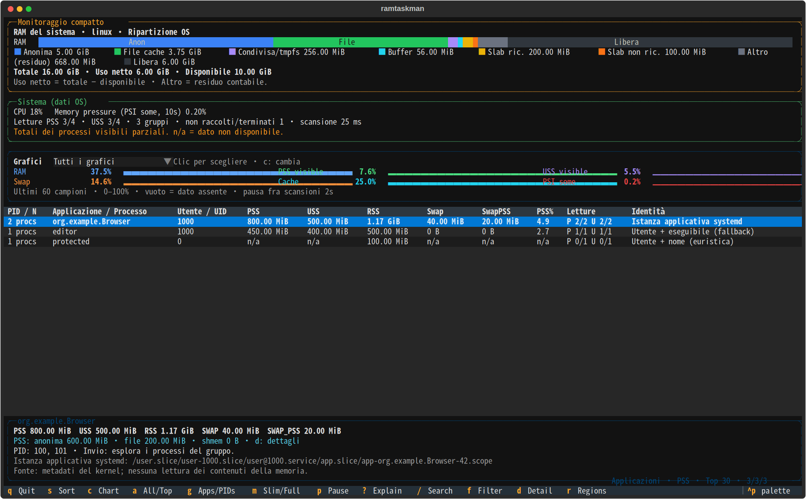
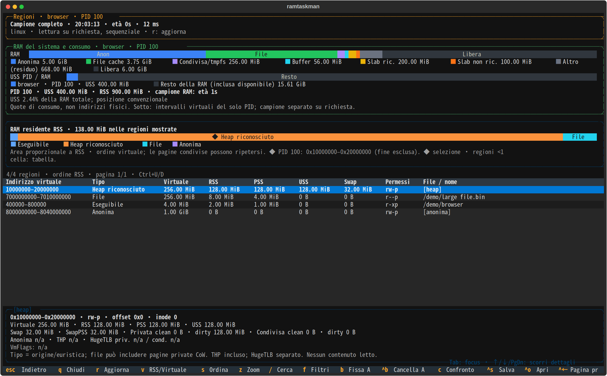

# ramtaskman

[Italiano](../../README.md) · [English](README.en.md) · [中文（简体）](README.zh.md) · [한국어](README.ko.md) · [Français](README.fr.md) · [Tiếng Việt](README.vi.md) · [Español](README.es.md) · [Português](README.pt.md) · [Deutsch](README.de.md) · [日本語](README.ja.md)

### See where your RAM goes, right from the terminal.

ramtaskman is an experimental RAM monitor for Linux, Windows and macOS. It grew from curiosity and research into a practical way to understand memory across different systems without reaching for complicated tools. It is a Vibeware project.



*Real Textual interface captured on Linux with synthetic demonstration data. The screenshots show the current Italian interface.*


*Partial dashboard localization in six languages; captured on Linux with synthetic data.*

## What you can do

1. See system RAM, available memory, cache and history at a glance; choose Slim or Full diagnostics.
2. Explore applications and processes, sort the available metrics and inspect measurement coverage.
3. Understand RSS and USS; on Linux also inspect PSS, swap and SwapPSS, with details and missing values clearly marked.
4. Search by name, executable or exact PID; filter by user, swap or partial readings.
5. Explore process memory regions on Linux; the Windows virtual-address view is experimental.
6. Compare two snapshots and save or reopen captures locally, including offline.

## A closer look




## Get started

Requires Python 3.11+ and uv. Linux requires /proc and smaps_rollup. The first run needs network access to install locked dependencies. The launchers keep the environment and cache in the project directory.

```bash
git clone https://github.com/umbertotechnopreneur/ramtaskman.git
cd ramtaskman
./run.sh
```

On Windows, from the project directory in Windows Terminal:

```powershell
.\run.cmd
```

Use --once or --json for a single reading or JSON output. Do not share a .venv between operating systems; recreate it locally. The project is not published on PyPI.

Useful keys: m switches modes, g toggles apps/processes, / searches, f filters, d opens details, r opens regions, ? explains metrics and q quits. The complete technical guide is currently in Italian.

The dashboard can be started with `./run.sh --language en` (on Windows: `.\run.cmd --language en`). Dashboard localization is partial: detailed explanations, regions, errors and some controls remain in Italian or English.

## Experimental: read the numbers carefully

Readings are sequential, permissions may restrict visibility, and application grouping is heuristic. Missing data is n/a, not zero. RSS may double-count shared pages; process PSS is not total system RAM. Cache overlaps available memory. Process swap is not inferred from commit.

Linux provides PSS and per-process swap when readable. Windows and macOS do not expose them here. Linux regions use smaps; Windows regions are experimental virtual ranges; macOS region maps are not implemented. Local hardware verification has been performed on Linux; Windows and macOS still need native validation.

## Inspiration and thanks

Thank you to Scott Hanselman and GPU Taskman for the inspiration. ramtaskman reuses parts of that project and adapts its terminal interface to RAM; it is independent and not an official release. [Scott Hanselman](https://github.com/shanselman) · [GPU Taskman](https://github.com/shanselman/gputaskman) · [Provenance](../upstream.md)

Translations were prepared with AI assistance. Corrections from translators and native speakers are welcome.

[Full technical guide (Italian)](../guida.md) · [MIT license; original copyright retained.](../../LICENSE)
