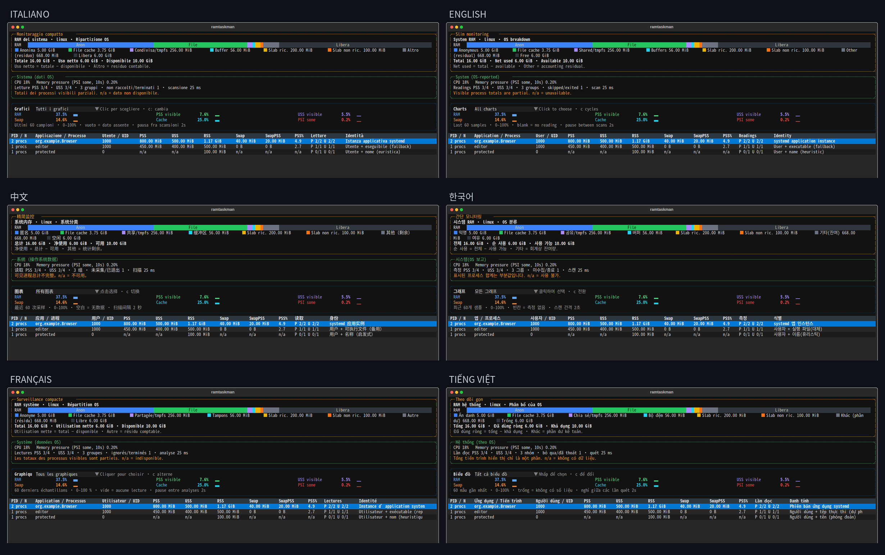

# ramtaskman

[Italiano](../../README.md) · [English](README.en.md) · [中文（简体）](README.zh.md) · [한국어](README.ko.md) · [Français](README.fr.md) · [Tiếng Việt](README.vi.md) · [Español](README.es.md) · [Português](README.pt.md) · [Deutsch](README.de.md) · [日本語](README.ja.md)

### Descubre adónde va la RAM, directamente desde la terminal.

ramtaskman es un monitor experimental de memoria para Linux, Windows y macOS. Nació de la curiosidad y la investigación para entender la memoria en distintos sistemas sin recurrir a herramientas complicadas. Es un proyecto Vibeware.


*Interfaz Textual real capturada en Linux con datos sintéticos de demostración. Las capturas muestran la interfaz italiana actual.*




*Traducción parcial de la pantalla principal en seis idiomas; capturas en Linux con datos sintéticos.*

## Funciones principales

1. Consulta RAM, memoria disponible, caché e historial de un vistazo; elige el modo Slim o diagnóstico completo.
2. Explora aplicaciones y procesos, ordena las métricas disponibles y comprueba la cobertura.
3. Consulta RSS y USS; en Linux también PSS, swap y SwapPSS, con detalles y datos ausentes indicados.
4. Busca por nombre, ejecutable o PID exacto y filtra por usuario, swap o datos parciales.
5. Explora regiones de memoria en Linux; la vista virtual de Windows es experimental.
6. Compara dos muestras y guarda o abre capturas locales, incluso sin conexión.

## Un vistazo al interior


## Cómo empezar

Se necesitan Python 3.11+ y uv. Linux requiere /proc y smaps_rollup. El primer inicio necesita red para instalar las dependencias fijadas. El entorno y la caché permanecen en el proyecto.

```bash
git clone https://github.com/umbertotechnopreneur/ramtaskman.git
cd ramtaskman
./run.sh
```

En Windows, desde la carpeta del proyecto en Windows Terminal:

```powershell
.\run.cmd
```

Usa --once o --json para una muestra única o salida JSON. No compartas .venv entre sistemas: vuelve a crearlo localmente. El proyecto no está publicado en PyPI.

Teclas útiles: m cambia de modo, g alterna aplicaciones/procesos, / busca, f filtra, d muestra detalles, r abre regiones, ? explica las métricas y q sale. La guía técnica completa está actualmente en italiano.

La pantalla principal se inicia con `./run.sh --language es` (Windows: `.\run.cmd --language es`). La traducción es parcial: explicaciones detalladas, regiones, errores y algunos controles siguen en italiano o inglés.

## Experimental: interpreta los datos con cuidado

Las lecturas son secuenciales, los permisos pueden limitar la visibilidad y la agrupación de aplicaciones es heurística. Los datos ausentes son n/a, no cero. RSS puede contar páginas compartidas varias veces; la PSS de procesos no es toda la RAM. La caché se solapa con la memoria disponible. La swap por proceso no se deduce del commit.

Linux ofrece PSS y swap por proceso cuando son legibles. Aquí no se exponen en Windows ni macOS. Las regiones Linux usan smaps; Windows muestra intervalos virtuales experimentales y macOS aún no tiene mapa. La verificación local en hardware se realizó en Linux; Windows y macOS necesitan validación nativa.

## Inspiración y agradecimientos

Gracias a Scott Hanselman y a GPU Taskman por la inspiración. ramtaskman reutiliza partes del proyecto y adapta su interfaz de terminal a la RAM; es independiente y no es una versión oficial. [Scott Hanselman](https://github.com/shanselman) · [GPU Taskman](https://github.com/shanselman/gputaskman) · [Provenance](../upstream.md)

Traducciones realizadas con ayuda de IA. Se agradecen las correcciones de traductores y hablantes nativos.

[Guía técnica completa (italiano)](../guida.md) · [Licencia MIT; se conserva el copyright original.](../../LICENSE)
