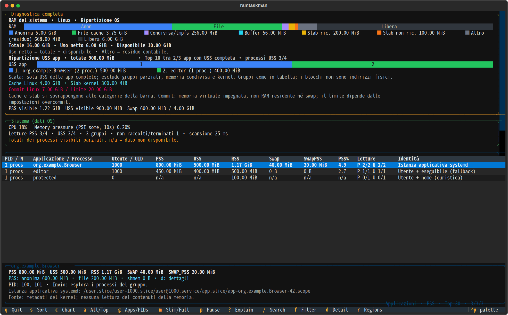

# ramtaskman

[Italiano](../../README.md) · [English](README.en.md) · [中文（简体）](README.zh.md) · [한국어](README.ko.md) · [Français](README.fr.md) · [Tiếng Việt](README.vi.md) · [Español](README.es.md) · [Português](README.pt.md) · [Deutsch](README.de.md) · [日本語](README.ja.md)

### Hiểu RAM đang được dùng vào đâu, ngay trong terminal.

ramtaskman là trình theo dõi bộ nhớ thử nghiệm cho Linux, Windows và macOS. Dự án xuất phát từ sự tò mò và nghiên cứu: hiểu bộ nhớ trên nhiều hệ thống mà không cần những công cụ quá phức tạp. Đây là một dự án Vibeware.


*Giao diện Textual thực tế được chụp trên Linux với dữ liệu minh họa tổng hợp. Ảnh hiện hiển thị giao diện tiếng Ý.*


*Bảng điều khiển được dịch một phần sang sáu ngôn ngữ; chụp trên Linux bằng dữ liệu tổng hợp.*

## Các chức năng chính

1. Xem RAM hệ thống, bộ nhớ khả dụng, bộ nhớ đệm và biểu đồ lịch sử; chọn chế độ Slim hoặc chẩn đoán đầy đủ.
2. Khám phá ứng dụng và tiến trình, sắp xếp theo chỉ số có sẵn và kiểm tra độ bao phủ của phép đo.
3. Xem RSS và USS; trên Linux còn có PSS, swap và SwapPSS, với dữ liệu thiếu được chỉ rõ.
4. Tìm theo tên, tệp thực thi hoặc PID chính xác; lọc theo người dùng, swap hay dữ liệu chưa đầy đủ.
5. Khám phá vùng nhớ tiến trình trên Linux; chế độ địa chỉ ảo Windows còn thử nghiệm.
6. So sánh hai mẫu, lưu và mở lại bản ghi cục bộ, kể cả khi ngoại tuyến.

## Xem bên trong




## Bắt đầu

Cần Python 3.11 trở lên và uv. Linux cần /proc và smaps_rollup. Lần chạy đầu cần mạng để cài các phụ thuộc đã khóa. Môi trường và bộ nhớ đệm nằm trong thư mục dự án.

```bash
git clone https://github.com/umbertotechnopreneur/ramtaskman.git
cd ramtaskman
./run.sh
```

Trên Windows, mở Windows Terminal tại thư mục dự án:

```powershell
.\run.cmd
```

Dùng --once để lấy một mẫu hoặc --json để xuất JSON. Không dùng chung .venv giữa các hệ điều hành; hãy tạo lại cục bộ. Dự án chưa được phát hành trên PyPI.

Phím hữu ích: m đổi chế độ, g đổi ứng dụng/tiến trình, / tìm kiếm, f lọc, d xem chi tiết, r mở vùng nhớ, ? giải thích chỉ số và q thoát. Hướng dẫn kỹ thuật đầy đủ hiện bằng tiếng Ý.

Chạy bảng điều khiển bằng `./run.sh --language vi` (Windows: `.\run.cmd --language vi`). Bản địa hóa chưa hoàn chỉnh: phần giải thích chi tiết, vùng nhớ, lỗi và một số điều khiển vẫn bằng tiếng Ý hoặc tiếng Anh.

## Dự án thử nghiệm: hãy đọc số liệu cẩn thận

Các phép đọc diễn ra tuần tự, quyền truy cập có thể hạn chế khả năng quan sát và việc nhóm ứng dụng chỉ là phương pháp phỏng đoán. Dữ liệu thiếu là n/a, không phải số không. RSS có thể đếm trùng trang chia sẻ; PSS của tiến trình không phải tổng RAM. Bộ nhớ đệm chồng lấp với bộ nhớ khả dụng. Swap của tiến trình không được suy ra từ commit.

Linux cung cấp PSS và swap theo tiến trình khi có thể đọc. Ở đây Windows và macOS không cung cấp các chỉ số này. Vùng nhớ Linux dùng smaps; Windows chỉ có khoảng địa chỉ ảo thử nghiệm; macOS chưa có bản đồ. Đã kiểm tra phần cứng thực trên Linux; Windows và macOS vẫn cần xác thực gốc.

## Cảm hứng và lời cảm ơn

Xin cảm ơn Scott Hanselman và GPU Taskman vì nguồn cảm hứng. ramtaskman tái sử dụng một phần dự án và điều chỉnh giao diện terminal cho RAM; đây là dự án độc lập, không phải bản phát hành chính thức. [Scott Hanselman](https://github.com/shanselman) · [GPU Taskman](https://github.com/shanselman/gputaskman) · [Provenance](../upstream.md)

Bản dịch được thực hiện với sự hỗ trợ của AI. Rất hoan nghênh góp ý từ dịch giả và người bản ngữ.

[Hướng dẫn kỹ thuật đầy đủ (tiếng Ý)](../guida.md) · [Giấy phép MIT; giữ nguyên bản quyền gốc.](../../LICENSE)
