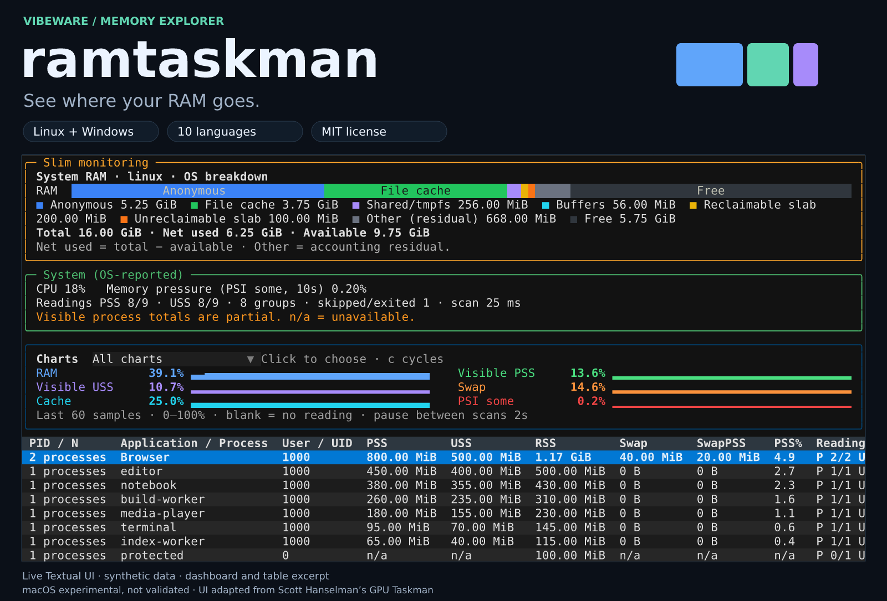

# ramtaskman

[Italiano](README.it.md) · [English](../../README.md) · [中文（简体）](README.zh.md) · [한국어](README.ko.md) · [Français](README.fr.md) · [Tiếng Việt](README.vi.md) · [Español](README.es.md) · [Português](README.pt.md) · [Deutsch](README.de.md) · [日本語](README.ja.md)

### 在终端中看清内存都用到了哪里。

ramtaskman 是一款在 Linux 和 Windows 上开发和测试的实验性内存监视器。它源于好奇心和研究，希望让人在不同系统上理解内存使用情况时，无须依赖复杂工具。这是一个 [VibeWare](https://umbertogiacobbi.biz/vibeware/manifesto) 项目。

项目也有一个实验性的 macOS 后端。我们没有 Mac，因此还没有在 Mac 上测试或验证它。项目的测试和 CI 目前只覆盖 Linux 和 Windows。

[文档](../README.md) · [参与贡献](../../CONTRIBUTING.md) · [MIT](../../LICENSE)



*在 Linux 上使用合成数据捕获的真实 Textual 界面。封面截取了概览和表格；示例界面使用英语。*

## 开始使用

需要 Python 3.11 或更高版本以及 uv。Linux 需要 /proc 和 smaps_rollup。首次运行需要网络安装锁定的依赖；环境和缓存保存在项目目录中。

```bash
git clone https://github.com/umbertotechnopreneur/ramtaskman.git
cd ramtaskman
./run.sh
```

在 Windows Terminal 中进入项目目录并运行：

```powershell
.\run.cmd
```

使用 --once 输出一次采样，或用 --json 输出 JSON。不要在不同操作系统之间共用 .venv；请在本地重新创建。项目尚未发布到 PyPI。

常用按键：m 切换模式，g 切换应用/进程，/ 搜索，f 筛选，d 查看详情，r 打开区域，? 解释指标，q 退出。完整技术指南目前为英语。

使用 `./run.sh --language zh` 启动中文主界面（Windows：`.\run.cmd --language zh`）。应用文本现已提供十种语言版本：`--language` 可选择界面、页脚、帮助、命令行和 `--once` 文本报告的语言，应用自身生成的技术消息也已翻译。标识符和 JSON 结构保持稳定；操作系统详情和已保存采集文件中的文本保留原始语言。本地验证范围为 Linux 和 Python 3.14.4：160×48 与 80×24 的合成数据界面、命令行、构建、隔离安装和回放。Windows 通过 CI 检查；macOS 不属于项目的验证范围。翻译仍有待母语者审校。

## 主要功能

1. 一览系统内存、可用内存、缓存和历史图表；切换精简与完整诊断模式。
2. 浏览应用和进程，按可用指标排序，并查看测量覆盖情况。
3. 查看 RSS 和 USS；在 Linux 上还可查看 PSS、交换空间和 SwapPSS，并明确标出缺失数据。
4. 按名称、可执行文件或精确 PID 搜索，并按用户、交换空间或不完整数据筛选。
5. 在 Linux 上浏览进程内存区域；Windows 虚拟地址视图仍属实验性功能。
6. 比较两个样本，在本地保存和重新打开采集文件，也支持离线查看。

## 界面一览


[图片库](../images/README.md) · [A/B](../images/regions-comparison.png) · [10 languages](../images/multilingual.png)

## RAM 价值与每月分摊

```bash
./run.sh --ram-price 320 --ram-currency EUR --ram-months 36
```

请自行输入整机 RAM 的价格；应用不会查询价格或发送网络请求。默认容量是操作系统可见的 RAM；标称 32 GiB 的套装可指定 `--ram-capacity-gib 32`。价值 = 价格 × 可归属字节数 / 容量。`--ram-months` 将此硬件价值除以所选月数：它不是账单、能耗、月平均值，也不保证节省费用。Linux 使用 PSS；Windows 使用 USS，仅计算私有驻留内存，不回退到 RSS。不完整的分组仍显示 n/a（JSON 中为 `null`）。不要将应用与其成员进程或系统内存重复相加。采样是顺序进行的，并非原子快照。JSON 仅在请求时添加 `ram_valuation`。F1 打开关于和致谢，Esc 返回监控。

## 实验性项目：请谨慎解读数据

采样是顺序进行的，权限可能限制可见性，应用分组采用启发式方法。不可用数据标为 n/a，而不是零。RSS 可能重复计算共享页；进程 PSS 不等于系统总内存。缓存与可用内存重叠；不会把 commit 推算为进程交换空间。

Linux 在可读取时提供 PSS 和每进程交换空间；Windows 和实验性 macOS 后端不提供这些指标。Linux 区域使用 smaps；Windows 仅提供实验性虚拟区间；macOS 尚无区域地图。项目验证涵盖本地 Linux 检查和原生 Windows CI 检查，macOS 不在此范围内。

个人 Windows PC 上的手动验证尚未完成。

## 使用、修改与分享

你可以依据 [MIT 许可证](../../LICENSE) 使用、复制、修改和重新分发 ramtaskman，包括商业用途。请在副本或实质性部分中保留版权及许可声明。软件不提供担保。欢迎贡献和翻译修正；依赖项保留各自的许可证。

[参与贡献](../../CONTRIBUTING.md) · [第三方声明](../../THIRD_PARTY_NOTICES.md)

## 灵感与致谢

感谢 Scott Hanselman 和 GPU Taskman 带来的灵感。ramtaskman 复用了该项目的部分内容，并将终端界面改用于内存监视；它是独立项目，并非官方版本。 [Scott Hanselman](https://github.com/shanselman) · [GPU Taskman](https://github.com/shanselman/gputaskman) · [Provenance](../upstream.md)

翻译由 AI 辅助完成，欢迎翻译人员和母语使用者提出修正。

[完整技术指南（英语）](../guida.md) · [MIT 许可证；保留原始版权声明。](../../LICENSE)
