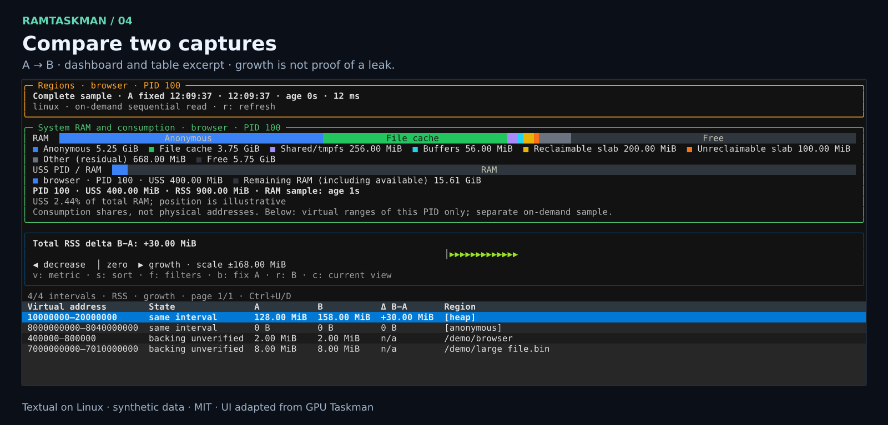

# Image gallery and reproduction

These images show the Textual application running on Linux with **synthetic data**.
Names, paths, counters, scan times and A/B changes are illustrative, not measurements
of the development computer. No memory contents are read. The UI derives from
[GPU Taskman](../upstream.md); its credits and [original MIT license](../../LICENSE)
are preserved.

We develop and test ramtaskman on Linux and Windows. This gallery shows the Linux
version. The macOS backend is experimental: we don't have a Mac, so we haven't
tested or validated it. Our CI covers Linux and Windows.
The main gallery uses the English UI; the multilingual image also includes Japanese.

The README footer uses the original VibeWare logo, stored separately as
`vibeware-logo.png`. It is copied unchanged, including its transparent canvas,
and is not generated by the screenshot scripts. Its [MIT notice](VIBEWARE_LICENSE.txt)
and [provenance](../../THIRD_PARTY_NOTICES.md) accompany it.

## Cover


The cover combines original SVG artwork with the first 29 rows of a 120×42 capture.
It shows the dashboard and table; the inspector and footer are in the full view
below. The small colored motif next to the title is decorative.

## Full overview


A 120×42 capture with eight synthetic groups. The table retains the application's
horizontal scrolling: columns on the right may be outside the viewport.
A protected process demonstrates `n/a` values and incomplete coverage.

## Full diagnostics


A crop of the `device` widget, measured during a 160×64 capture. Global RAM and
USS for complete applications only have different denominators. The shares do
not describe physical addresses. The full view remains in the corresponding local SVG.

## Process regions


The first 29 rows of a 160×64 capture: summary, RAM context, map and table.
Map area follows RSS; addresses are virtual. The inspector and footer are outside
the crop. Mapped files and memory bytes are not read.

## A/B comparison



The same crop as the region view. The fixture increases heap RSS, PSS, USS and
private dirty memory by 30 MiB in the second sample, leaving other regions unchanged.
This demonstrates comparison; it is not evidence of a leak or a benchmark.

## Ten languages


Labels show all available languages; the two examples are crops of the RAM panel
actually rendered in English and Japanese. The script also captures the other
eight languages. Translations still need native-speaker review.
Graphic headings are in English so the images can be shared across localized READMEs.

## Regenerate on Linux

Python 3.11+, uv, Fontconfig (`fc-match`) and the **DejaVu Sans**, **DejaVu Sans Mono**
and **Noto Sans CJK SC** fonts must be installed on the system.
Check availability before rendering:

```bash
fc-match 'DejaVu Sans Mono'
fc-match 'Noto Sans CJK SC'
UV_CACHE_DIR="$PWD/.uv-cache" uv run --locked --group images python tools/capture_screenshots.py
UV_CACHE_DIR="$PWD/.uv-cache" uv run --locked --group images python tools/render_readme_images.py
```

Run from the repository root. The optional `images` group pins resvg-py in the
lockfile; it adds no dependencies to the installed application. Environment and
cache stay in the project, with no model downloads or GPU use. Initial installation
may need network access; rendering uses only local fonts and files.

The sequence produces:

1. `captures/*.svg`: original Textual screenshots, including 160×48 and 80×24.
2. `captures/gallery-*.json`: dimensions and crop coordinates in cells.
3. `captures/artwork-*.svg`: compositions before PNG rendering.
4. `docs/images/*.png`: the six images to review and include in the repository.

`captures/` is ignored by Git. Synthetic measurements follow a deterministic sequence;
timestamps, ages and font rasterization may vary between runs and systems.
Binary identity across machines is not guaranteed. Scripts do not embed or download
fonts; their licenses are listed in the [notices](../../THIRD_PARTY_NOTICES.md).

The renderer preserves SVG text positions and widths, removes CDN font references
and replaces the export's desktop frame with a neutral frame. Displayed values
are not retouched. To change the data, edit the fixture in `tools/capture_screenshots.py`
and capture the application again. Rendering uses the
[resvg-py API](https://resvg-py.readthedocs.io/en/latest/api.html) and resvg's support
for the SVG `textLength` and `lengthAdjust` attributes.

Review every image at README width and full resolution: no overlapping text,
readable CJK glyphs, declared crops, and preserved coverage and reasons for `n/a`.
Do not substitute screenshots of real processes.
